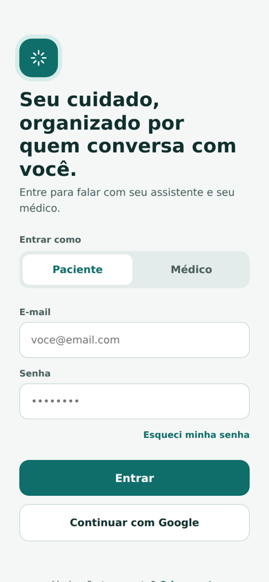
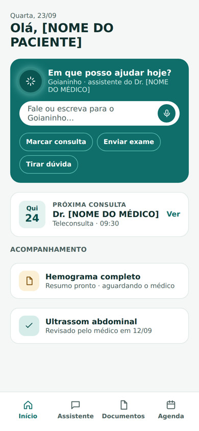
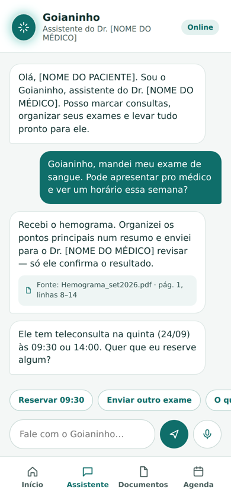
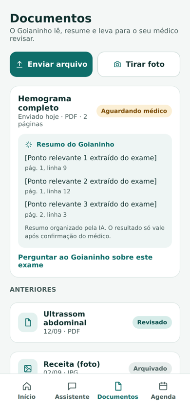
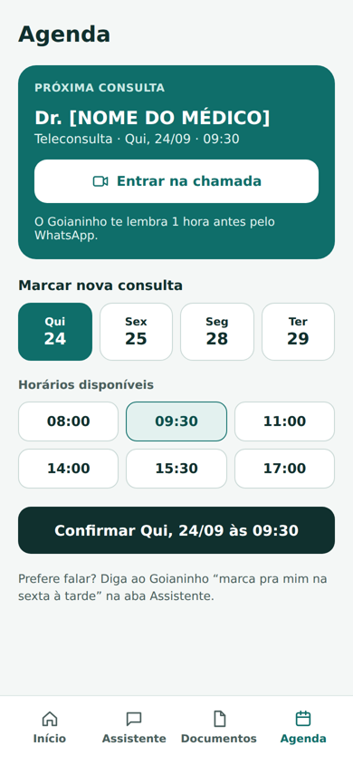
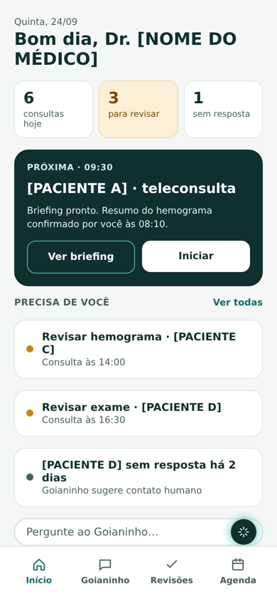
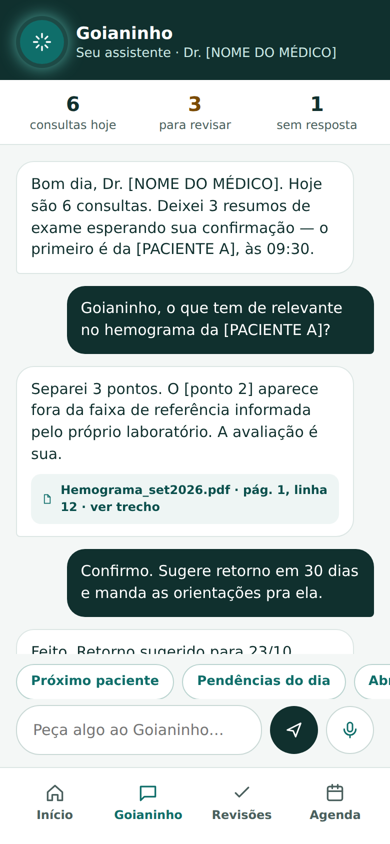
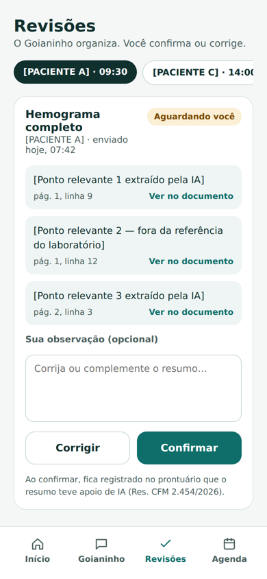
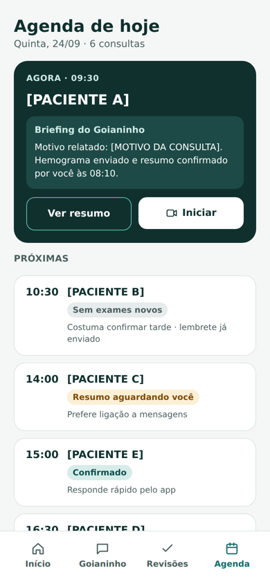

# Goianinho Medicina

**Um app Android que conecta paciente e médico por meio de um assistente de IA, o Goianinho, que organiza exames, agenda consultas e prepara tudo para o médico decidir.**


> Projeto da disciplina **Softwares para Dispositivos Móveis** — Engenharia de Software, Centro Universitário Alfredo Nasser (UNIFAN).

---

## Sobre o projeto

Entre o paciente precisar de atendimento e o médico atender bem existe um processo fragmentado: fila, exames que chegam desorganizados, agendamento manual e o médico perdendo tempo juntando informação.

O **Goianinho** é um assistente conversacional que acompanha os dois lados:

- **O paciente** fala em linguagem natural ("marca minha consulta", "manda meu exame pro médico") e o Goianinho executa.
- **O médico** recebe resumos prontos, com a **fonte de cada informação** (arquivo, página e linha), e só confirma ou corrige.

O mercado já tem peças soltas (triagem, agendamento, escriba de consulta). Aqui elas ficam juntas numa única conversa contínua, para paciente e médico.

### Princípios

| | Princípio |
|---|---|
| 🩺 | **A IA apoia, o médico decide.** O Goianinho nunca apresenta diagnóstico. Todo resumo fica "aguardando médico" até a confirmação. |
| 🔎 | **Toda informação tem fonte.** Cada ponto de um resumo mostra de onde saiu. |
| 💬 | **Linguagem natural primeiro.** Tudo pode ser feito conversando; botões são atalhos. |
| 🤝 | **Simples para quem não é da tecnologia.** Textos curtos, botões grandes e opção de voz. |

Esses princípios seguem a Resolução CFM nº 2.454/2026, que regulamenta o uso de IA na medicina no Brasil.

---

## Telas

### Visão do paciente

| Login | Início | Chat com o Goianinho | Documentos | Agenda |
|:---:|:---:|:---:|:---:|:---:|
|  |  |  |  |  |

### Visão do médico

| Início | Goianinho do médico | Revisão de resumos | Agenda do dia |
|:---:|:---:|:---:|:---:|
|  |  |  |  |

> As imagens são do protótipo. Os nomes entre colchetes, como `[NOME DO MÉDICO]`, são marcadores de exemplo.

---

## Tecnologias

| Camada | Tecnologia |
|---|---|
| Linguagem | Kotlin |
| Interface | Jetpack Compose + Material 3 |
| Arquitetura | MVVM (Screen + ViewModel + StateFlow + Repository) |
| Navegação | Navigation Compose |
| Login | Firebase Authentication (e-mail e senha) |
| Banco de dados | Cloud Firestore (cache offline do próprio Firestore; sem Room) |
| Assíncrono | Kotlin Coroutines + `Flow` (`kotlinx-coroutines-play-services` para `.await()`) |
| Injeção de dependência | Manual, com `AppContainer` (sem Hilt) |
| Imagens | Coil (`AsyncImage`) |
| IDE | IntelliJ IDEA com plugin Android |
| IA | Simulada nesta fase (respostas fixas), pronta para ser trocada por uma IA real |

Tudo roda no **plano gratuito (Spark)** do Firebase, sem Firebase Storage (exige plano Blaze).

---

## Arquitetura

O projeto segue o MVVM recomendado pelo Google ([Guide to app architecture](https://developer.android.com/topic/architecture)):

```
Tela (Screen)  ──evento──▶  ViewModel  ──▶  Repository  ──▶  Firebase
     ▲                          │                ▲
     └──── UiState (StateFlow) ─┘          AppContainer
```

- **Tela:** só desenha o `UiState` (Carregando / Sucesso / Erro) e repassa cliques.
- **ViewModel:** guarda o estado, valida e decide o que fazer. É criada por uma `Factory` que pega o Repository no `AppContainer`.
- **Repository:** é o único que fala com o Firebase. Listas em tempo real saem como `Flow`; ações (gravar, confirmar, reservar) são `suspend` e devolvem `Result`, nunca lançam erro para a tela.
- **AppContainer:** criado uma vez pelo `GoianinhoApp`; instancia o Firebase e os 4 repositórios.

### Estrutura de pastas

```
app/src/main/java/com/goianinho/medicina/
 ├── MainActivity.kt         Abre o tema e a navegação
 ├── GoianinhoApp.kt         Application: cria o AppContainer (v1.6)
 ├── ui/
 │    ├── login/             Módulo 1 — Login e Criar conta
 │    ├── home/              Módulo 1 — Início do paciente e do médico, barra de 4 abas
 │    ├── chat/              Módulo 2 — Chat com o Goianinho
 │    ├── documentos/        Módulo 3 — Documentos e Revisão
 │    ├── agenda/            Módulo 4 — Agenda e Chamada em breve
 │    ├── comum/             Componentes compartilhados: Mensagens.kt (erros e avisos padrão),
 │    │                      EstadosDeTela.kt (TelaCarregando, TelaErro, EstadoVazio), AvisoErro,
 │    │                      ConsultaDoMomento e TelaEmConstrucao
 │    └── theme/             Cores e tipografia
 ├── data/
 │    ├── AppContainer.kt    Cria o Firebase e os 4 repositórios (v1.6)
 │    ├── Constantes.kt      MEDICO_TESTE_ID e nomes das coleções (v1.6)
 │    ├── model/             Classes de dados (Firestore): Usuario, Mensagem, Documento, Horario, Consulta
 │    └── repository/        Acesso ao Firebase — cada módulo tem o seu (Auth, Mensagem, Documento, Agenda),
 │                           mais ErrosAuth, ErrosFirestore e RespostasSimuladas
 └── navigation/             AppNavigation e objeto Rotas (11 rotas)
```

Cada pasta de módulo tem um **`doc.md`** com as telas, os requisitos, **o que já existe e o que falta na v1.6**, o código de referência e as aulas do Google para aquele módulo.

| Módulo | Guia |
|---|---|
| 1 · Login | [`ui/login/doc.md`](app/src/main/java/com/goianinho/medicina/ui/login/doc.md) |
| 1 · Início | [`ui/home/doc.md`](app/src/main/java/com/goianinho/medicina/ui/home/doc.md) |
| 2 · Chat | [`ui/chat/doc.md`](app/src/main/java/com/goianinho/medicina/ui/chat/doc.md) |
| 3 · Documentos | [`ui/documentos/doc.md`](app/src/main/java/com/goianinho/medicina/ui/documentos/doc.md) |
| 4 · Agenda | [`ui/agenda/doc.md`](app/src/main/java/com/goianinho/medicina/ui/agenda/doc.md) |

A especificação completa está em [`docs/Documentacao-Goianinho-Medicina-v1.6.pdf`](docs/Documentacao-Goianinho-Medicina-v1.6.pdf).

---

## Fase atual — v1.6: backend no Firebase

O front-end da primeira fase está pronto. Agora cada tela deixa de ser só visual: **lê e grava dados reais, trata erros, segue as regras de negócio e funciona em qualquer tamanho de tela.**

### O que precisa funcionar em cada módulo

| Módulo | Entrega da fase 2 |
|---|---|
| **1 · Login e Início** | Login real com perfil salvo (aviso se o seletor divergir) · Criar conta grava `usuarios` com `medicoId` e `criadoEm`, e desfaz a conta no Auth se falhar (RN-11, RN-12) · Esqueci a senha · Continuar logado (RF-07) · Sair (RF-37) · Início só lê, em tempo real (RN-10) |
| **2 · Chat** | Histórico por `donoId` em tempo real · "Goianinho está digitando…" (RF-38) · respostas simuladas com gatilhos e fonte do exame mais recente · se falhar, o texto volta para o campo |
| **3 · Documentos** | Enviar arquivo e foto (máx. 1280 px, até 700 KB em Base64) · "Ver no documento" com Coil · paciente vê "Aguardando revisão do Dr. X" (RN-05) · Corrigir exige observação (RN-13) |
| **4 · Agenda** | Horários livres só a partir de agora (RN-14) · reserva por transação (RN-08) · próxima consulta em tempo real · agenda do médico com status do resumo · chamada mostra aviso "em breve" |

### Erros a corrigir

A revisão do código atual (22/11/2026) encontrou **56 erros**, listados com arquivo, linha e correção na seção **"Erros encontrados no código atual"** de cada `doc.md`:

| Módulo | Erros | 🔴 Alta | Exemplos |
|---|---|---|---|
| 1 · Login (L-01 a L-12) | 12 | 2 | Conta pela metade quando o perfil não grava; paciente novo sem médico |
| 1 · Início (H-01 a H-09) | 9 | 1 | "Assumir paciente" grava a partir do Início (fere RN-10) |
| 2 · Chat (C-01 a C-11) | 11 | 3 | Texto perdido se o envio falha; chat para sem `donoId` com as novas regras |
| 3 · Documentos (D-01 a D-12) | 12 | 3 | Corrigir sem observação; clique duplo duplica documento; app fecha sem câmera |
| 4 · Agenda (A-01 a A-12) | 12 | 2 | Consulta marcada no dia errado ao trocar de dia; app fecha com horário mal cadastrado |

Os 🔴 são corrigidos **primeiro**, cada um num commit `fix(modulo): ... (ID)`.

### Requisitos de qualidade (todos os módulos)

| ID | Requisito |
|---|---|
| RNF-01 | Botão de algo que ainda não existe (Google, voz, videochamada) mostra aviso "em breve" |
| RNF-02 | Toda chamada ao Firebase com tratamento de erro; mensagem em português e o app nunca fecha |
| RNF-03 | Indicador de carregamento e botão desabilitado enquanto espera o Firebase |
| RNF-04 | Telas responsivas: 360 dp, celular grande, deitado e fonte grande |
| RNF-05 | Lista vazia mostra um texto explicando |
| RNF-06 | Validação antes de gravar, com erro embaixo do campo |
| RNF-07 | Erros no Logcat (`Log.e("Goianinho", ...)`) e bugs de teste viram Issue |
| RNF-08 | Regras do Firestore por usuário; nunca logar senha nem dado de saúde |

### Ordem de trabalho

1. **Líder — ✅ base entregue:** Coil e coroutines no Gradle, `GoianinhoApp`, `AppContainer`, `Constantes`, `Mensagens.kt`, `EstadosDeTela.kt`, campo `donoId` em `Mensagem` e `firestore.rules` reescrito. Ainda são passos manuais do líder (spec, seção 7): criar o médico de teste e colocar o UID em `MEDICO_TESTE_ID` (hoje placeholder) e criar os horários de exemplo.
   - **Decisão B:** a base não migra os módulos. Cada módulo migra o **próprio** repositório (construtor com `db`), a **própria** linha do `AppContainer`, a `Factory` e a troca de `traduzirErro*` por `mensagemDeErro`. O roteiro está em "O que o líder entrega na `main`" de cada `doc.md`.
2. **Módulo 1** entrega o login funcional primeiro (os outros dependem do usuário logado).
3. **Módulos 2, 3 e 4** em paralelo, cada um na sua branch, abrindo PR por etapa.
4. **Testes cruzados:** cada integrante testa o módulo de outro com a checklist de pronto e abre Issues.
5. **Antes da apresentação:** o líder publica as regras de segurança do Firestore por usuário (seção 11 da documentação).

> **Regras do Firestore:** já estão escritas em `firestore.rules`, mas **não publicadas**. Publicá-las antes de os 4 módulos migrarem (`donoId` no chat, fim do "Assumir paciente", vínculo RN-12) quebra o app. Quem publica é o líder, depois da migração.

### Checklist de pronto (todo PR da fase 2)

- [ ] Tela com `UiState` Carregando / Sucesso / Erro
- [ ] Nenhuma chamada ao Firebase fora do Repository
- [ ] Testado em modo avião: mensagem de erro e o app não fecha
- [ ] Botões sem função mostram o aviso "em breve"
- [ ] Botões de ação desabilitados enquanto carrega
- [ ] Testado em celular pequeno, grande, deitado e com fonte grande
- [ ] Regras de negócio conferidas nos dois perfis
- [ ] Nenhum log com senha ou dado de saúde
- [ ] Visual igual ao protótipo

---

## Como rodar

**Pré-requisitos**

- IntelliJ IDEA com o plugin **Android** ativado
- **Android SDK** instalado (API 36)
- **JDK 21**
- Celular Android com depuração USB ativada, ou um emulador

**Passos**

```bash
git clone https://github.com/Dhyegoreis/projeto_app.git
cd projeto_app
```

1. Abra a pasta no IntelliJ IDEA e espere a sincronização do Gradle terminar.
2. Conecte o celular (ou inicie um emulador).
3. Clique em **Run ▶**.

O arquivo `google-services.json` já está no repositório (privado), então o app conecta ao Firebase do projeto sem configuração extra. Ele não é uma senha: identifica o projeto e vai dentro de todo APK. A proteção real dos dados vem das regras do Firestore.

**Usuário de teste:** `paciente.teste@goianinho.com` (paciente). Na fase 2 o líder cria também o médico de teste, ao qual todo paciente novo é vinculado (RN-12).

**Primeira execução de uma lista:** se o Logcat mostrar `FAILED_PRECONDITION`, a consulta precisa de índice composto — abra o link do Logcat, crie o índice e avise o líder.

---

## Equipe

| Módulo | Responsável | Branch | Visão do paciente | Visão do médico |
|---|---|---|---|---|
| 1 · Login e Início | [INTEGRANTE 1] | `feature/login` | Login e Início | Início |
| 2 · Chat com o Goianinho | [INTEGRANTE 2] | `feature/chat-ia` | Chat | Goianinho do médico |
| 3 · Documentos | [INTEGRANTE 3] | `feature/documentos` | Documentos | Revisão de resumos |
| 4 · Agenda | [INTEGRANTE 4] | `feature/agenda` | Agenda | Agenda do dia |

**Líder do projeto e arquitetura:** Dhyego Ferreira dos Reis

**Equipe de desenvolvimento e testes:**

- Felipe Caetano
- Antony Gabriel
- João Victor de Sousa
- Dhyego Ferreira dos Reis

### Como o time trabalha

- Cada integrante trabalha **somente na sua branch**.
- A `main` é alterada **apenas pelo líder**, por meio de Pull Request revisado e aprovado.
- Commits seguem o padrão `feat(modulo): descrição` ou `fix(modulo): descrição`.
- Gradle, `theme/`, `navigation/`, `data/model/`, `AppContainer` e `ui/comum/` só mudam com aviso no grupo e decisão do líder.
- **Bug encontrado em teste vira Issue** com a etiqueta `bug`: título curto, passos para reproduzir, esperado, o que aconteceu, print ou Logcat e a branch. A correção cita a Issue (`fix(chat): ... Corrige #12`).

---

## Roadmap

- [x] Protótipo das 9 telas
- [x] Documentação do projeto e dos módulos
- [x] **Etapa 0** — Fundação: Firebase, tema, modelos de dados e navegação
- [x] **Etapa 1** — Telas visuais de cada módulo
- [ ] **Etapa 2** — Integração com Firebase (Auth e Firestore) · ⏳ em andamento (v1.6)
- [ ] **Etapa 3** — Navegação ponta a ponta e testes entre módulos
- [ ] **Etapa 4** — Ajustes finais e demonstração

**Próximas fases (fora do escopo atual):** IA real (LLM) respondendo no chat, leitura real de exames (OCR + resumo), upload de arquivos (Firebase Storage), videochamada, canal WhatsApp e ligação, aprendizado do perfil de engajamento e IA que sugere hipótese clínica.

---

## Aviso

Projeto acadêmico, em desenvolvimento. O app **não emite diagnóstico** nem substitui a avaliação de um profissional de saúde. Os dados exibidos nas telas são fictícios.

---

*Projeto elaborado e arquitetado por **Dhyego Ferreira dos Reis**.*
